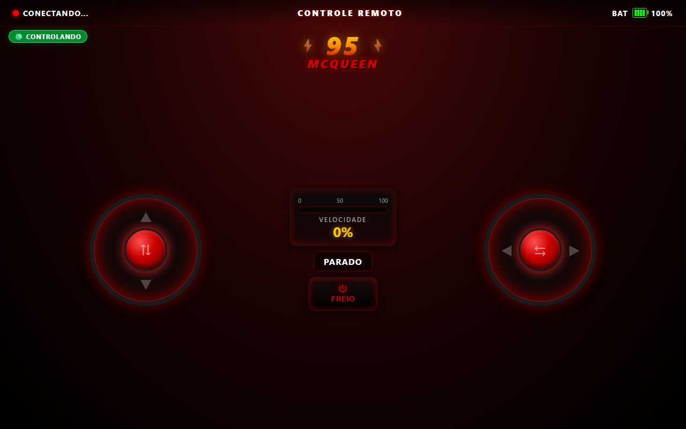

# 🏎️ CAR MCQueen — Controle Remoto

Controle web responsivo para carrinho RC com display OLED animado e direção differential drive (estilo tanque).

> 🌐 **Demo ao vivo:** [car-mc-queen.vercel.app](https://car-mc-queen.vercel.app)

> 🚧 **Em desenvolvimento.** O controle web já funciona (modo DEMO, sem o carrinho). As peças
> estão a caminho — próximos passos: montar o chassi, gravar o firmware e
> testar o controle com o carrinho de verdade.



## ⚡ Features

- **Joysticks touch reais** — drag com mouse ou dedo
- **Differential drive** — combina throttle + steering pra curvas suaves
- **Modo dual** — funciona desconectado (DEMO) ou conectado ao carrinho via WebSocket
- **Responsivo** — escala fluido de iPhone SE até iPad
- **Sem build, sem framework** — HTML/CSS/JS puro

## 🕹️ Controles

| Joystick | Eixo | Função |
|---|---|---|
| Esquerdo | Vertical (▲▼) | Frente / Ré (acelerador) |
| Direito | Horizontal (◀▶) | Esquerda / Direita (direção) |
| Combinados | — | Curva enquanto se move (differential drive) |
| Botão central | — | FREIO (para emergência) |

## 🛠️ Hardware (em construção)

- Microcontrolador com Wi-Fi
- L298N (driver de motor)
- 2× motores TT amarelos + chassi 2WD
- OLED SSD1306 128×64 I²C (carinha do McQueen)
- Bateria 2× 18650 + TP4056 (carregamento USB)

## 📡 Protocolo WebSocket

Cliente envia comandos em texto plano na porta 81:

| Comando | Significado |
|---|---|
| `c<throttle>,<steering>` | Differential drive — valores de -255 a +255 |
| `s` | Para tudo (emergency stop) |

Exemplo: `c200,100` = throttle 200 (frente), steering 100 (curva direita leve)

Firmware faz mixing: `leftMotor = throttle + steering`, `rightMotor = throttle - steering`.

## 🧪 Desenvolvimento local

```bash
# Servir local pra testar em outro device da mesma rede
python -m http.server 8000

# Ou com Node
npx serve -p 8000
```

Acessa no celular: `http://IP_DO_PC:8000`

## 📦 Stack

- HTML + CSS3 + Vanilla JS
- Hospedado em Vercel
- Firmware em C++ (repo separado)

## 🚧 Roadmap

- [ ] Firmware em modo dual (AP + STA + Hotspot)
- [ ] mDNS pra resolver `mcqueen.local`
- [ ] WiFiManager pra configuração de Wi-Fi sem flash
- [ ] PWA (instalável na tela inicial do celular)
- [ ] Telemetria: bateria real, temperatura
- [ ] Sensor ultrassom HC-SR04 (auto-stop)
